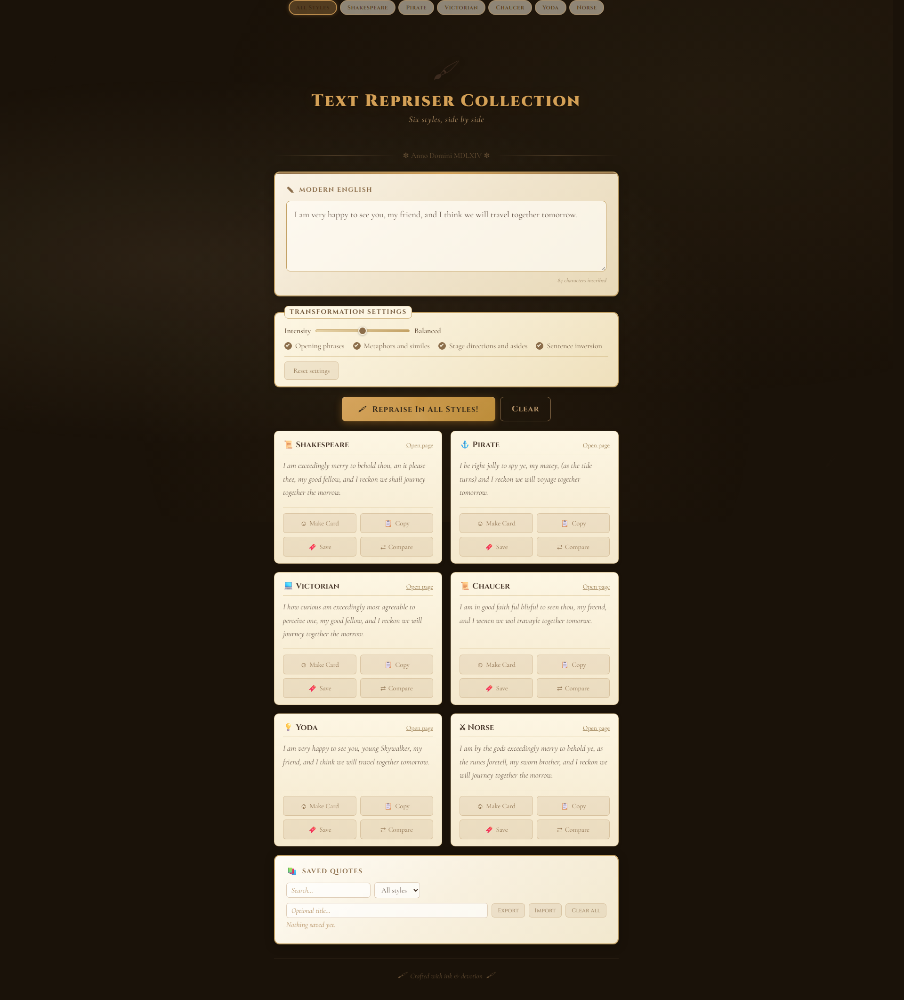

# Text Repriser Collection

A collection of single-page web apps that rewrite modern English into six
literary and historical styles. Everything runs client-side in the
browser. Each page is fully self-contained (bundled word data, CSS, and
JavaScript) with zero dependencies.



## Live Demo

Hosted with GitHub Pages: **[Live site](https://cuber7649.github.io/shakespeare-repriser/)**

| Page | Link |
| ----- | ---- |
| Dashboard (all styles at once) | [Open](https://cuber7649.github.io/shakespeare-repriser/index.html) |
| Shakespeare | [Open](https://cuber7649.github.io/shakespeare-repriser/shakespeare.html) |
| Pirate | [Open](https://cuber7649.github.io/shakespeare-repriser/pirate.html) |
| Victorian | [Open](https://cuber7649.github.io/shakespeare-repriser/victorian.html) |
| Chaucer | [Open](https://cuber7649.github.io/shakespeare-repriser/chaucer.html) |
| Yoda | [Open](https://cuber7649.github.io/shakespeare-repriser/yoda.html) |
| Norse | [Open](https://cuber7649.github.io/shakespeare-repriser/norse.html) |

The site is installable: browsers that support web apps will offer to install
it from `manifest.json`, and iOS users can use Share → Add to Home Screen.

## Styles

| Page | Style | Example |
| ---- | ----- | ------- |
| `shakespeare.html` | Elizabethan English | "how are you" → "How dost thou fare" |
| `pirate.html` | Golden Age of Piracy | "you are my friend" → "Ye be my matey" |
| `victorian.html` | Victorian English | "really" → "Truly"; "you are" → "One is" |
| `chaucer.html` | Middle English | "you are happy" → "Thou art blisful" |
| `yoda.html` | Jedi Master speech | "you are brave" → "Are you brave"; "I love the bright sun" → "The bright sun, I love" (object–subject–verb) |
| `norse.html` | Vikings and Norse myth | "you are happy" → "Ye are merry" |

## Features

- **Themed word replacement** — hundreds of verbs, adjectives, nouns, and phrases per style
- **Sentence-level transforms** — e.g. "I want to" becomes "my heart hungereth to" (Norse) or "I be yearning to" (Pirate)
- **Contraction handling** — e.g. "don't" becomes "thou dost nat" (Chaucer) or "ye do not" (Norse)
- **Random quotations** — Shakespeare, Austen, the Hávamál, pirate sayings, and Jedi wisdom
- **Themed insults** — e.g. "ye scurvy dog", "thou cherl", "you insufferable bounder"
- **Dramatic asides and stage directions** — e.g. "[The longship sets sail.]"
- **Metaphors and similes** — e.g. "as fierce as a berserker", "as wild as the open sea"
- **Sentence inversion** — reordered syntax for emphasis
- **Transformation settings** — an intensity control (Light, Balanced,
  Dramatic) plus toggles for opening phrases, metaphors and similes, stage
  directions and asides, and sentence inversion, on every page and the
  dashboard. Balanced with everything on matches the original behaviour;
  choices are remembered in your browser and follow you between pages
- **Style-switcher navigation** — move between styles from any page
- **Side-by-side dashboard** — one input, all six styles at once, on `index.html`
- **Original/output comparison** — a Compare button beside every result opens
  a word-by-word diff of your input against the rewrite, lining the two up and
  marking what changed
- **Quote card export** — turn any style's output into a shareable 1080×1350
  PNG, previewed before you save it. Pick a skin (the page's own look,
  parchment, midnight, or verdant), a background (lit parchment, flat, or
  wash), text alignment, and whether the original text appears in a band
  beneath the quote. Asides and stage directions are stripped so only the
  speech appears. Long text shrinks to fit the card (never below a readable
  size), and the preview warns you when it had to shrink a lot or when the end
  has been cut short. Open it from the dashboard or from the Make Card button
  beside Copy and Save on every style page.
- **Saved quotes** — keep a list of quotes you like: Save stores the output
  together with your original input, the style, the settings, and an optional
  title (up to 50 quotes, newest first), shared by the dashboard and every
  style page. Search the list, filter by style, load a quote back with Use,
  regenerate it with Re-run, delete single rows or clear everything, export to
  `repriser-quotes.json`, and import that file back — duplicates are skipped
  and malformed files are rejected with a message
- **Installable web app** — `manifest.json` plus generated icons, no backend
- **Keyboard shortcut** — press Ctrl+Enter to transform
- **Copy to clipboard** — supported on local files and HTTPS, with an announced confirmation
- **Responsive layout** — verified from mobile to desktop viewports
- **Screen-reader support** — live regions announce results and copy confirmations; every input has a real label
- **Reduced-motion support** — all decorative animation stops when the OS asks for it
- **Family-friendly content** — all word lists audited; no profanity, slurs, or explicit material, enforced by a test over every line the site can display

## Getting Started

No build step or installation is required — the pages run straight from
`file://` or from any static file server you prefer.

1. Open `index.html` for all styles at once, or any single style page (start
   with `shakespeare.html`), or use the live demo above.
2. Enter modern English text in the input field.
3. Click the transform button, or press **Ctrl+Enter**.
4. Copy the result with the **Copy to Clipboard** button.

> `index.html` is a generated file. Editing it directly will be overwritten the
> next time the dashboard is rebuilt; change a style page instead.

## Examples

| Input | Style | Output |
| ----- | ----- | ------ |
| `hello how are you today` | Shakespeare | Hail how dost thou fare this day |
| `hello how are you today` | Pirate | Ahoy how be ye today |
| `hello how are you today` | Chaucer | Hail how fareth thou today |
| `hello how are you today` | Norse | Hail how fare ye this day |
| `I am so happy to see my friend` | Pirate | I be so jolly to spy my matey |
| `I am so happy to see my friend` | Chaucer | I am so blisful to seen my freend |
| `we will travel tomorrow and find the treasure` | Victorian | We will journey the morrow and come upon the treasure |
| `we will travel tomorrow and find the treasure` | Norse | We will journey the morrow and come upon the treasure |
| `you are brave` | Yoda | Are you brave |
| `I like pie` | Yoda | Pie, I like |
| `he whispered a terrible secret` | Yoda | A terrible secret, he whispered |
| `the old king ruled the land` | Yoda | The land, the old king ruled |

> These are single runs. Output varies each time — openings, interjections,
> metaphors, alliterations, asides and stage directions are all rolled at
> random, so `"hello how are you today"` might equally come out as
> `"Hail how as I live dost thou fare this day"`.

## Project Structure

```text
shakespeare-repriser/
├── index.html         # Dashboard: all six styles side by side (generated)
├── shakespeare.html   # Elizabethan style (original page)
├── pirate.html        # Pirate style
├── victorian.html     # Victorian style
├── chaucer.html       # Middle English style
├── yoda.html          # Yoda speech style
├── norse.html         # Norse style
├── manifest.json      # Web app manifest, for installability
├── icon-180.png       # App icons (generated)
├── icon-192.png
├── icon-512.png
├── icon.svg           # Scalable SVG favicon (generated)
├── package.json       # build and test commands (no dependencies)
├── README.md
├── LICENSE            # free use; credit + GitHub link required if commercial
├── Screenshot.png
└── tools/             # build + test tooling (not shipped to the browser)
```

Each `.html` file is a standalone app: open it directly in a browser or serve the
directory with any static file server. There are no shared runtime files.

Two files here are **generated** rather than hand-written:

- **`index.html`** — the side-by-side dashboard. It is the one page that needs
  every dictionary in a single file, so it is built from the six style pages by
  copying each page's dictionaries, engine, helpers and transform function
  verbatim. That keeps this repository free of shared runtime files while making
  it impossible for the dashboard to drift from the individual pages.
- **`icon-*.png`, `icon.svg` and `manifest.json`** — drawn programmatically, so
  there is no image editor in the loop; the artwork is a round medallion on a
  square canvas, which keeps the install and iOS home-screen icons maskable-safe,
  and the SVG is the crisp primary favicon in browsers that support it.

The generator and test scripts live in [`tools/`](./tools/README.md), with a
README of their own. Shared logic — transformation settings, saved quotes, the
comparison view, the quote-card modal — lives once under `tools/` and is pasted
verbatim into every page, so each page stays a standalone file that cannot drift
from its neighbours. To change it:

1. Edit the file under `tools/`, never its pasted copies inside the `.html`
   pages or `index.html`.
2. Run `node tools/paste-shared.mjs` to repaste all six style pages and
   rebuild the dashboard.
3. Run the suite before committing:

```bash
npm run build   # regenerate index.html from the six style pages
npm test        # run the whole suite (build + 24 checks, ~2 min)
```

`npm test` includes `paste-shared --check`, which fails the build the moment a
pasted copy or a generated file no longer matches its source; the same check
runs in `node tools/prepush-check.mjs`.

There are no dependencies — `npm install` is never needed.

## Browser Support

Works in modern browsers (Chrome, Edge, Firefox, Safari), on desktop and
mobile. Known limitations: the automated browser suite runs only in headless
Chromium/Edge, so other engines are not covered by it; and an internet
connection is only needed for the Google Fonts stylesheets — offline, the apps
fall back to system serif fonts.

## Privacy

Everything runs in your browser, on your device: there is no backend,
account, analytics, or tracking of any kind. Saved quotes live in your
browser's `localStorage` under `repriser.savedQuotes` and your transformation
settings under `repriser.settings`, shared between this site's pages on the
same origin (the dashboard and all six styles) and never sent anywhere. The
only network requests the pages make are for the Google Fonts stylesheets.
Clearing site data removes both — use Export first if you want to keep your
saved quotes.

## License

Free to use however you like. If you use it **commercially** — in a product,
service, or anything you are paid for — give credit to the author on GitHub by
linking to their profile, [github.com/Cuber7649](https://github.com/Cuber7649),
and to this project,
[github.com/Cuber7649/shakespeare-repriser](https://github.com/Cuber7649/shakespeare-repriser).
Non-commercial use needs no attribution. The full terms are in
[`LICENSE`](./LICENSE), matching the `"license": "SEE LICENSE IN LICENSE"`
field in `package.json`.
